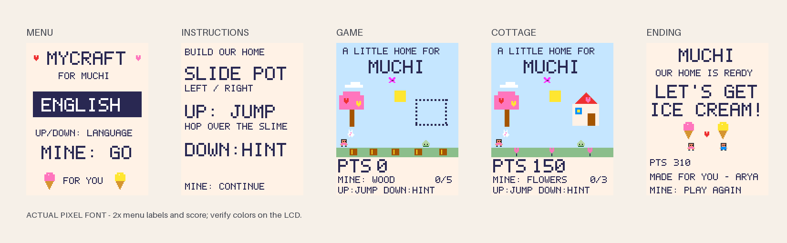

# MyCraft — A Little Home for Muchi

A simple gift game for MSPM0G3507: collect five pieces of wood, build a cottage in five stages, pick three flowers, and reveal “Muchi, let's get ice cream.” Pink cherry tree, red roof, yellow accents, blue window and two characters in the ending. English and Spanish. This is a source update for your existing Lab 9 CCS project, not a complete toolchain distribution.

## Install
Replace the existing project's Lab9Main.c, Sound.c, Sound.h, LED.c and LED.h. Add CozySounds.h next to Sound.c. Replace the linked ../inc/DAC5.c with the supplied DAC5.c (compile exactly one copy). Keep your working ADC1, Switch, Clock, LaunchPad, Timer and ST7735 course drivers. The existing repository ECE319K_Lab9.zip is an older archive, not this version.

If you installed the previous Cozy update, only Lab9Main.c changed in this edition. No new header is required. Keep the 80 MHz initialization; audio and timer constants assume that clock. Choose the appropriate MYCRAFT_LCD_TAB for your panel (default INITR_REDTAB).

## Controls
- Slide PB18: left to move left, center to stop, right to move right.
- PB16 UP: jump over the slime; UP/DOWN select startup language.
- PB19 DOWN: show a hint. It no longer changes materials.
- PB12 MINE: collect a nearby item when on the ground; advance menus.
- PB17 BUILD: when prompted, stand beneath the marked cottage at the right and press five times to build.

The HUD always identifies the next task and its count. Collecting wood/flowers once awards points. Bumps lose at most five points and cause a short invulnerability interval; they never reset progress. Five placed cottage parts are actual visual building stages. Completion awards 100 additional points. Replay starts fresh. A clean completion earns 310 points.

## Testing
Set MYCRAFT_TEST_MODE to 0 ADC, 1 languages, 2 art, 3 switches/LED, 4 sound or 5 final game. The LED diagnostic uses the on-board PB27 LED; no extra LED or joystick is required. Keep the supplied working active-low switch driver and ADC driver.

Host tests: `python3 tests/run.py` (GCC). Preview: `python3 tests/preview.py` (Pillow). Tests check a complete objective sequence, replay, debounce/mailbox behavior, collision grace, bounds, bilingual text fit and sound. They do not establish a successful CCS build, target timing or hardware operation.

Read COURSE_MAP.md for primary course links and limits, CHECKOUT_GUIDE.md for function explanations, REQUIREMENTS.md for the rubric and VIDEO_PLAN.md for recording.

## Hardware limitations
ADCin is your existing blocking driver. Confirm it completes reliably inside TIMG12 at the configured clock. Verify ADC input bandwidth below 15 Hz for nominal 30 Hz sampling; software alone does not guarantee anti-aliasing. This simpler semaphore can coalesce ticks when drawing is too slow; inspect MyCraft_MissedFrames and measure worst-case service time. Game animation slows if main misses ticks. The short main critical section also briefly delays audio, so measure timing under load. This version has not been flashed or tested on your board here.

## Provenance
Custom game implementation and artwork developed with assistant help, based on your supplied drivers and public course concepts. Source mapping is not exact-lecture certification. Respect your section's assistance rules. No third-party artwork is embedded; OpenGameArt remains an optional resource. No grade or social-media performance is guaranteed.
